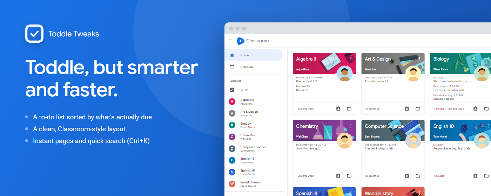
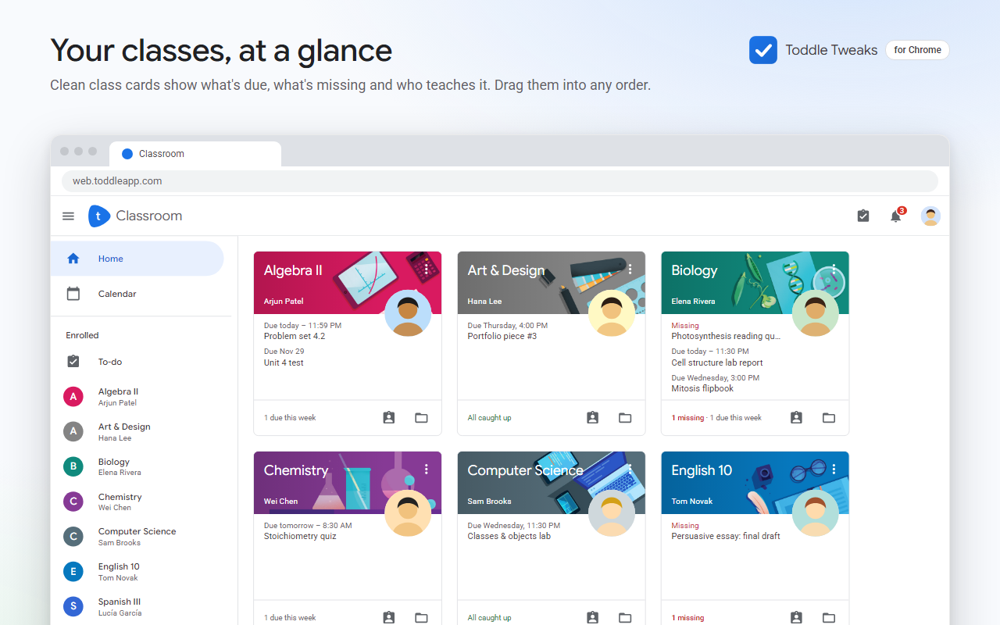
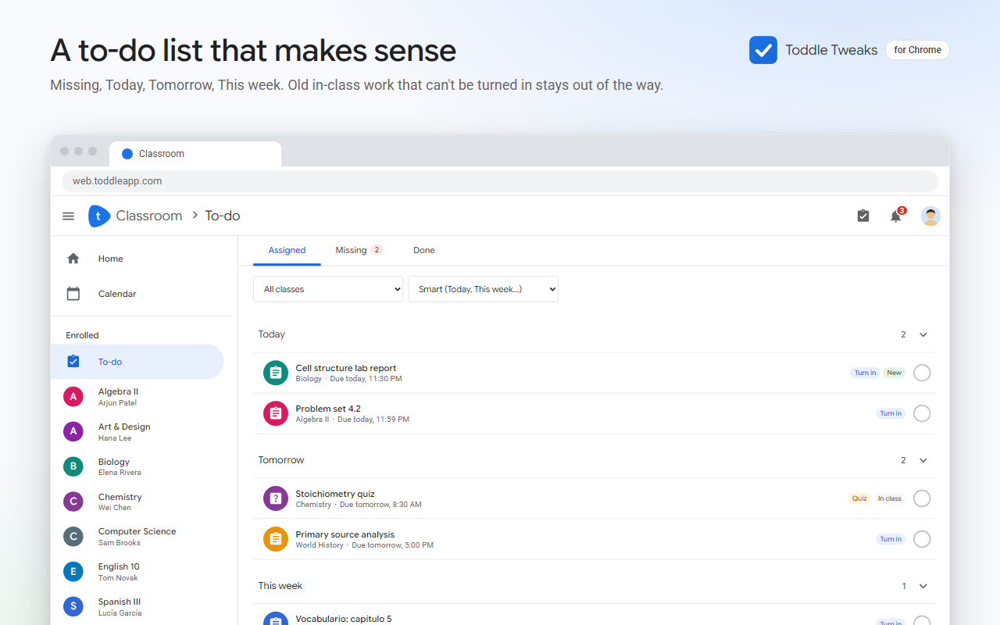
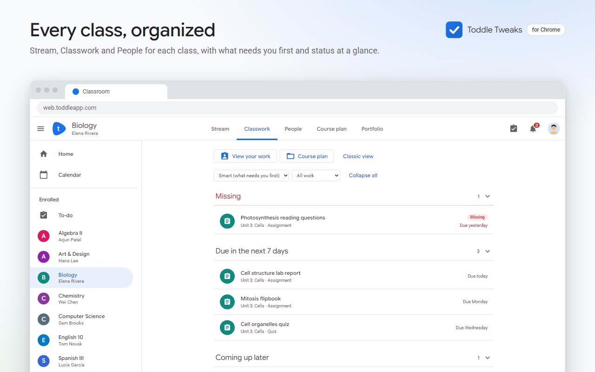
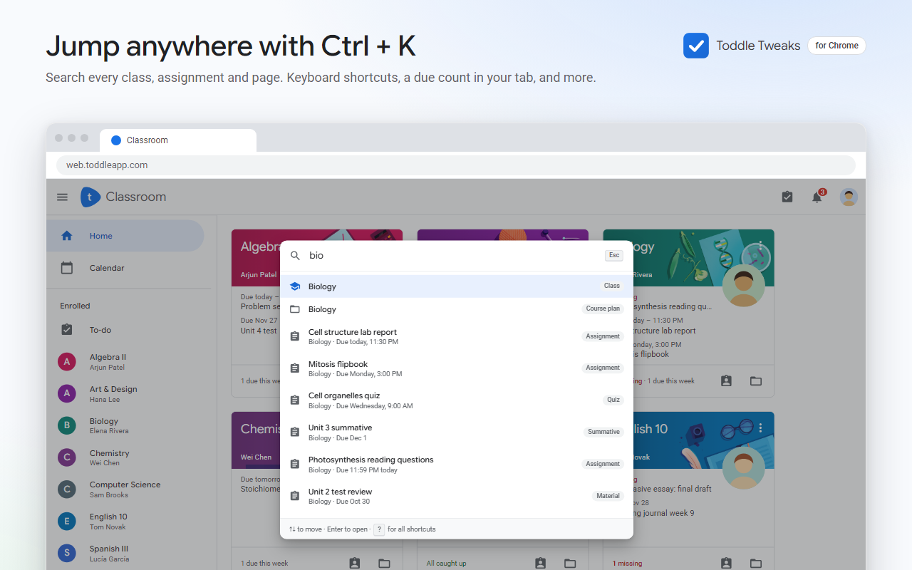
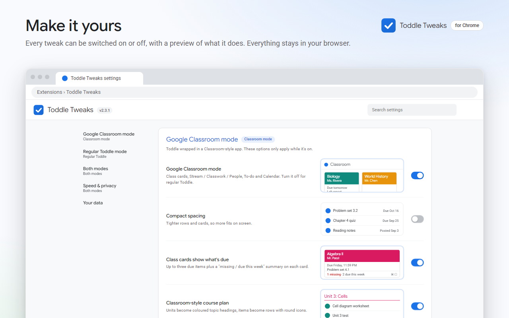

# Toddle Tweaks

A Chrome and Firefox extension that makes Toddle (web.toddleapp.com) faster and saner.

**Free and open source** under the [MIT License](LICENSE). Bug reports, ideas and pull requests are welcome in [Issues](https://github.com/Jotspot/toddle-tweaks/issues).



## Get it

> **Verified at Singapore American School only (so far).** Other schools set up Toddle differently, so some features may behave differently. If something looks off at your school, please [open an issue](https://github.com/Jotspot/toddle-tweaks/issues).

- **Chrome Web Store:** coming soon
- **Firefox Add-ons:** coming soon

Until then you can install it by hand (see [Install (developer mode)](#install-developer-mode) below). For Firefox 128+, open `about:debugging` → This Firefox → **Load Temporary Add-on…** and pick `manifest.json` from a Firefox build (`node scripts/build.mjs`, then `dist/firefox`).

## Screenshots

| | |
|---|---|
|  |  |
| **Your classes, at a glance:** class cards with what's due and what's missing | **A to-do list that makes sense:** Missing, Today, Tomorrow, This week |
|  |  |
| **Every class, organized:** Stream, Classwork and People | **Jump anywhere:** Ctrl/⌘ + K searches every class and assignment |
|  | |
| **Make it yours:** every tweak can be switched on or off, with previews | |

_All screenshots use made-up example classes and people._

## Install (developer mode)

1. Open `chrome://extensions`
2. Turn on **Developer mode** (top right)
3. Click **Load unpacked** and pick this folder (`Toddle Tweaks`)
4. Open (or reload) Toddle. Visit your Toddle **home page** once so the extension can learn your classes.

After editing any file, hit the ↻ reload button on the extension card, then reload Toddle.

## What it does

### Speed
- **Instant page snapshots.** Toddle downloads and parses ~60 MB of JavaScript on every load. While that happens, Toddle Tweaks shows your last view of the page right away, with a small “Cached view · loading live Toddle…” pill, then fades to the real page. Click something on the snapshot and it gets clicked for you once Toddle is ready.
- **GraphQL cache.** Config-type queries (preferences, configuration, course list, grade details, LTI settings…) are served from a local cache instantly and refreshed in the background for next time. Anything about assignments, submissions, notifications, etc. is never cached. Any change you make (a mutation) clears the volatile cache.
- **Turbo cache** (off by default): caches almost every query. Fastest, but a page can be one visit out of date.
- **Skip the marketing site.** toddleapp.com redirects straight to the web app.
- **Tracker blocking.** Sentry, Google Analytics, HubSpot, Facebook/Reddit/Twitter pixels, Mixpanel, etc. Optional: hide the Intercom chat bubble.

### Smart to-do
Toddle's “Pending” list is every assignment since August, oldest first. 54 of 80 of them were in-class items that can never be turned in. The smart to-do:
- Groups work by **Missing → Today → Tomorrow → This week → Next week → Later → No due date**.
- Treats past **“submission not required”** items as done (“Auto-done”), so they don't bury real work.
- Tags **Quiz / Test / Summative**, **Turn in** (needs a submission) and **New** (posted in the last 3 days).
- Lets you tick items off locally, with filters by class, plus sort by class or by recently assigned.
- Shows up on the classic home page (replacing “Assignments and deadlines”), as the To-do page in Classroom mode, with **Alt+T**, and in the toolbar popup with a badge count.
- Sort by smart buckets, due date (either direction), recently assigned, class, type (tests first) or A–Z.
- **Bulk “Mark as done” in Toddle:** under *Done → Auto-done*, a button marks every past “no submission needed” item as done in Toddle. It makes the same call as Toddle's own “Mark as done” button (verified against it), never sends response text, refuses items that take a real submission, and asks first.

### Google Classroom mode
Turn it on in the popup. Toddle gets wrapped in a Classroom-style shell, drawn at document_start from cached data, so the old Toddle UI never flashes:
- **Top bar + drawer**: Home, Calendar, To-do, your classes (with teachers), and the school pages (announcements, school calendar, timetable, attendance, policies).
- **Home**: Classroom cards that use Google Classroom's own banner illustrations (picked by subject, changeable via ⋮ → Change theme), teacher photos from Toddle, and what's due soon. Drag cards to reorder them, and hide ones you don't need.
- **Class pages**: Stream (announcements + “posted a new assignment”, an All / Announcements / Classwork posts filter, Upcoming box), Classwork (grouped by unit like Classroom topics; click a row to expand its instructions), People (teachers + classmates with photos), a Classroom-style Course plan (topics, folders, links, your assignment status, search), and Toddle's Portfolio.
- **To-do** (Assigned / Missing / Done) and a week **Calendar** of due work.
- Toddle pages without a Classroom equivalent (assignment pages, attendance, school announcements…) show inside the shell, restyled. Assignment pages get Classroom's coloured title and “Your work” card.
- Notifications: the bell opens Toddle's notification panel on the right.
- The avatar menu → “Switch to classic Toddle” turns it off.

### Handy extras (each one can be switched off)
- **Settings page**, grouped into Classroom mode / Regular Toddle / Both modes, with previews where they help: popup → “All settings & previews”, the drawer's “Toddle Tweaks settings”, or `g` `s`.
- **Quick jump**: Ctrl/⌘ + K searches every class, assignment and page.
- **Keyboard shortcuts**: `g h` home, `g t` to-do, `g c` calendar, `g s` settings, `?` for help.
- **Tab badge**: “(3) …” in the tab title = missing + due today/tomorrow.
- **Relative due dates** on assignment pages (“· in 4 days”).
- **Export to calendar**: Calendar page → “Export to calendar (.ics)” for Google/Apple/Outlook, with a reminder 12 hours before each due date.
- **Advanced class settings** (bottom of a card's ⋮ menu): rename a class, add a section line, pick which teacher is shown (or type one), hide it, or restore the original. Only changes what you see.
- **Take a tour** of Classroom mode from the menu, the account card or the home page.
- **Smarter Classwork**: “Smart (what needs you first)” order (Missing → next 7 days → later → no due date → done & past), status pills (Missing / Turned in / Graded) and the item type on every row.
- **Faster course plans**: cached and shown instantly, refreshed in the background.

### Small things
- **Middle-click / Ctrl-click** class cards and assignment cards to open them in a new tab (Toddle uses clickable `<div>`s, so this normally doesn't work).

## Releasing

```
node scripts/build.mjs          # dist/toddle-tweaks-chrome-<v>.zip and dist/toddle-tweaks-firefox-<v>.zip
node scripts/render-promo.mjs   # store/images/chrome/* and store/images/firefox/* (demo data, no real accounts)
npx web-ext lint -s dist/firefox
```

- Bump `version` in `manifest.json` (and add a line to `CHANGELOG.md`) before each upload.
- Store builds strip the developer-only reload hooks (`// @dev-start … // @dev-end`).
- Firefox build: MV3 with `background.scripts`, `options_ui`, gecko id `toddle-tweaks@toddletweaks.app`, Firefox 128+, `data_collection_permissions: none`.
- Listing text, permission justifications, reviewer notes and the data-use answers are in `store/LISTING.md`. The privacy policy is `store/privacy-policy.html` (host it somewhere public and paste the URL).
- Promo images are rendered from `store/promo/*.html`, which run the real extension UI with made-up classes and people.

## How it works

| File | World | When | Job |
|---|---|---|---|
| `src/page-hook.js` | page (MAIN) | document_start | Wraps `fetch`: GraphQL cache, records Toddle's task filters, learns “Mark as done” |
| `src/common.js`, `src/boot.js` | isolated | document_start | Settings, theme classes, instant snapshot overlay |
| `src/api.js` | isolated | document_start | Calls Toddle's GraphQL with your existing session token |
| `src/snapshot.js` | isolated | document_start | Saves a snapshot of each page once it settles |
| `src/todo.js` | isolated | document_start | Categorising + rendering the smart to-do |
| `src/gc/*.js` | isolated | document_start | Classroom shell, themes, home, class pages, to-do, calendar |
| `src/classroom.js` | isolated | idle | Classic-mode home smart to-do panel |
| `src/app.js` | isolated | document_start | Mounting, FAB, new-tab links, shortcuts, popup messages |
| `background.js` | service worker | | Tracker rulesets, toolbar badge |

Everything is stored locally (page IndexedDB `toddle-tweaks`, localStorage keys prefixed `tt:`, `chrome.storage`). Nothing is sent anywhere except Toddle's own API.

## License

[MIT](LICENSE) © 2026 Jamie Perry. Toddle Tweaks is an independent project and is not affiliated with Toddle or Google.
